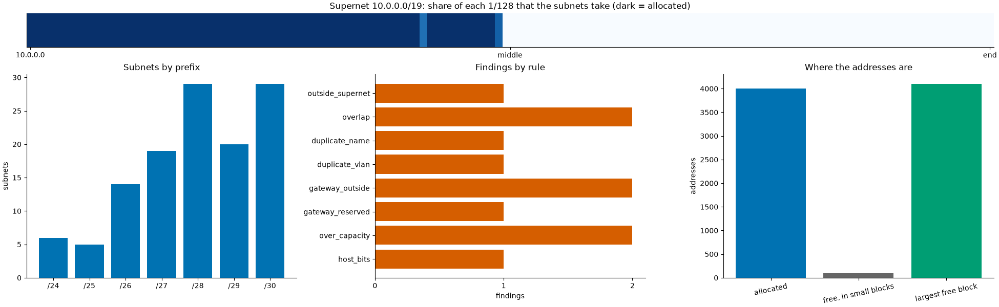

# ipam: plan an IPv4 address space, with checks that are checked two ways

[](https://github.com/TexAlphaWolf/net-ipam-planner/actions/workflows/ci.yml)
[](https://github.com/TexAlphaWolf/net-ipam-planner/actions/workflows/codeql.yml)


A small IP address management tool for the questions that come up when an address plan is drawn in a spreadsheet: **how do I
divide 10.0.0.0/16 among networks of different sizes (VLSM), does anything overlap or stick out of the supernet, is the gateway
really an address of its subnet, does each subnet hold the hosts planned for it, and what is left?** `ipam` allocates subnets by
number of hosts, checks a plan against eight rules, lists the free space as CIDR blocks and reports on a plan. Every result is
computed twice, with the standard library's `ipaddress` and with a deliberately literal implementation written on integers, and
a generator that knows which faults it put into a plan scores what the checks find. A command line (`ipam`) with tests, a Docker
image and reports generated from the numbers.



## What the numbers say

The demo plan ([`docs/report.json`](docs/report.json)) is a generated plan of 122 subnets in 10.0.0.0/19 (8,192 addresses), made
consistent and then given 11 faults. **It is synthetic**: the faults are the ones the generator injects, so a detection score is a
ceiling and not an estimate of what you would find in a real address plan. Speed figures are from one run in Docker on Linux
x86_64 with 12 CPUs and Python 3.14.10 ([`docs/bench.json`](docs/bench.json); medians of 5 runs, 3 for the literal implementation).

1. **The checks find all 375 faults injected into 50 plans, and report nothing else.** Each plan (200 subnets) is built consistent
   (50 of 50 had 0 findings before any fault went in), then 0 to 2 faults of each of the 8 kinds are injected at random places:
   375 faults, 375 reported, 0 missed, 0 reports that are not an injected fault. This says the rules and the generator mean the same
   thing; it does not say the rules cover everything that goes wrong in a real plan.
2. **Two implementations, one answer.** The `ipaddress` implementation and the literal one give the same findings in the same order,
   the same free blocks and the same placements on 102 comparisons (2 generated plans, 50 random messy plans and 50 random
   allocations): 8,296 values, all equal. The tests also push hand-computed cases through both and show the comparison can fail.
3. **The demo has 11 faults and the checks report those 11.** Two subnets with a smaller subnet inside them, one subnet outside the
   supernet, a repeated name, a repeated VLAN, two gateways that are not in their subnet, one that is the network address, two
   subnets planned for more hosts than they hold, and one address written with host bits (10.0.15.109/30).
4. **Free space is exact and shortest.** The demo allocates 4,004 of the 8,192 addresses (48.9%); the remaining 4,188 are 5
   CIDR blocks, the largest a /20 (4,096), so only 2.2% of the free space lies outside it.
5. **Allocation is a few microseconds a request.** 10,000 requests are placed in 31.4 ms (237 us for 100: 2.4 us a request, 3.1 us
   at 10,000). The literal allocation takes 77.3 ms for 100 requests, 326 times longer, and it was timed only up to 200
   requests.
6. **Checking is near linear, and the literal check is quadratic.** Checking 100,000 subnets takes 2.33 s; 10,000 take 202.4 ms
   (16.2 us to 23.3 us a subnet from 1,000 to 100,000, a little worse than linear because of the sort). The literal check compares
   every pair: 71.5 ms at 1,000 subnets and 6.40 s at 10,000, which is 90 times more for 10 times the subnets.
7. **The value of having both is the agreement.** The literal check is simple enough to read in a minute; the fast one is 4.4 times
   faster at 1,000 subnets and 31.6 times at 10,000, and the gap widens. The two never differ.

[`docs/analysis.md`](docs/analysis.md) goes through the results; [`docs/method.md`](docs/method.md) defines the file format, every
rule and the allocation exactly; [`docs/architecture.md`](docs/architecture.md) shows how the pieces fit;
[`docs/report.md`](docs/report.md) and [`docs/bench.md`](docs/bench.md) are the generated reports.

## Quick start

With Docker (nothing else to install):

```bash
docker build -t ipam .
docker volume create ipamv
docker run --rm --user 0 -v ipamv:/data --entrypoint chown ipam 10001 /data
RUN="docker run --rm --read-only --tmpfs /tmp --cap-drop ALL --security-opt no-new-privileges --network none -v ipamv:/data ipam"
$RUN generate /data/dc --subnets 60 --seed 3                  # a synthetic plan and its truth
$RUN check /data/dc/plan.json --truth /data/dc/truth.json     # exit code 1: there are findings
$RUN alloc --supernet 10.9.0.0/24 --need web=100 --need db=20 --need lab=6
```

With Python 3.11 to 3.14:

```bash
pip install .
ipam alloc --supernet 10.9.0.0/24 --need web=100 --need db=20 --need lab=6 -o plan.json
ipam check plan.json              # what is wrong, if anything (exit code 1 when there is something)
ipam free plan.json               # the free space as CIDR blocks
ipam report plan.json --out out   # report.json, report.md and summary.png
```

## Real output

`ipam report` (the demo plan):

```text
demo plan (synthetic, 120 subnets, seed 1, with injected faults): supernet 10.0.0.0/19, 122 subnets, 48.9% of the 8,192 addresses allocated
11 findings: 1 outside_supernet, 2 overlap, 1 duplicate_name, 1 duplicate_vlan, 2 gateway_outside, 1 gateway_reserved, 2 over_capacity, 1 host_bits
free: 4,188 addresses in 5 blocks, the largest is 10.0.16.0/20
against the injected faults: 11 of 11 found, 0 reports that are not an injected fault
```

`ipam check` on `ipam generate dc --subnets 60 --seed 3`:

```text
outside_supernet net-00013: 172.16.0.0/24 is not inside 10.0.0.0/19
overlap net-00000|overlap-000: net-00000 (10.0.0.0/24) and overlap-000 (10.0.0.0/25) share addresses
overlap net-00047|overlap-001: net-00047 (10.0.10.200/29) and overlap-001 (10.0.10.200/30) share addresses
duplicate_name net-00054: 2 subnets are called net-00054
duplicate_vlan 3999: VLAN 3999 is used by net-00041, net-00052
gateway_outside net-00032: gateway 203.0.113.1 of 10.0.10.16/28: the gateway is not an address of its subnet
gateway_outside net-00017: gateway 203.0.113.1 of 10.0.8.128/26: the gateway is not an address of its subnet
gateway_reserved net-00004: gateway 10.0.4.0 of 10.0.4.0/25: the gateway is the network or the broadcast address
over_capacity net-00036: 15 hosts planned in 10.0.10.80/28, which holds 14
over_capacity net-00022: 31 hosts planned in 10.0.9.64/27, which holds 30
host_bits net-00038: 10.0.10.113/28 is not the network address of 10.0.10.112/28
11 findings in 62 subnets
```

`ipam alloc --supernet 10.9.0.0/24 --need web=100 --need db=20 --need lab=6 --need big=1000` (exit code 1: one request does not fit):

```text
web                      10.9.0.0/25            100 hosts
db                       10.9.0.128/27           20 hosts
lab                      10.9.0.160/29            6 hosts
no room for: big
```

## The plan file

A plan is JSON: a supernet and its subnets. Only `name` and `cidr` are required for a subnet.

```json
{
 "name": "campus",
 "supernet": "10.0.0.0/16",
 "subnets": [
  {"name": "servers", "cidr": "10.0.0.0/24", "vlan": 10, "gateway": "10.0.0.1", "hosts": 120},
  {"name": "wifi", "cidr": "10.0.1.0/23", "vlan": 20, "gateway": "10.0.1.1", "hosts": 400}
 ]
}
```

The reader is strict (unknown keys, bad addresses, a supernet with host bits and VLAN numbers outside 1 to 4094 are errors that
say where), and addresses are parsed by a small parser of its own so that the loader does not depend on the library the fast
implementation uses. Details are in [`docs/method.md`](docs/method.md).

## Commands

| Command | What it does |
|---|---|
| `ipam check PLAN [--truth FILE] [--limit N] [--all]` | Runs the 8 checks; exit code 1 if there are findings |
| `ipam alloc (--plan FILE \| --supernet CIDR) (--need NAME=HOSTS ... \| --needs FILE.csv) [-o FILE]` | Places subnets for given numbers of hosts, first fit, largest first; with `-o` writes the plan with them added; exit code 1 if some do not fit |
| `ipam free PLAN [--limit N]` | The free space as the shortest list of CIDR blocks |
| `ipam generate DIR [--subnets N --seed S --clean]` | Writes `plan.json` and `truth.json`, a synthetic plan with injected faults (none with `--clean`); refuses to overwrite |
| `ipam report [PLAN] [--truth FILE] [--out DIR]` | The report (the demo without a plan): `report.json`, `report.md`, `summary.png` |
| `ipam verify [--draws N] [--seed S]` | Compares the two implementations; exit code 1 on a difference |
| `ipam bench [--sizes ...] [--ref-max N] [--alloc-sizes ...] [--alloc-ref-max N] [--repeat R] [--draws N] [--seeds N] [--out DIR]` | Speed, detection and agreement |
| `ipam render FILE.json [-o FILE.md] [--figure FILE.png]` | Rebuilds the Markdown (and figure) from a `report.json` or `bench.json` |

Exit codes: 0 success, 1 findings, subnets that do not fit or a verification mismatch, 2 an error (a missing or malformed file, a
request that cannot exist, a file that would be overwritten).

## The 8 checks

`outside_supernet`, `overlap`, `duplicate_name`, `duplicate_vlan`, `gateway_outside`, `gateway_reserved`, `over_capacity` and
`host_bits`. Each is defined in [`docs/method.md`](docs/method.md).

## How it is checked

- [`reference.py`](src/ipamplan/reference.py) is the same rules written as literally as possible: every pair of subnets compared,
  every address worked out from integers, every candidate block tried in turn. `ipam verify` compares it with the `ipaddress`
  based [`check.py`](src/ipamplan/check.py) on generated plans and on random messy ones (overlaps, subnets outside the supernet,
  host bits, repeated names and VLANs, odd gateways), and on random allocation requests. A finding is a rule and a subject; both
  must give the same list in the same order.
- An allocation is also checked without either implementation's search: every block is aligned, inside the supernet, big enough
  and shares no address with an existing subnet or another new one.
- The **generator** ([`generate.py`](src/ipamplan/generate.py)) builds a plan that is consistent by construction, then injects
  faults and writes down what it injected. `ipam check --truth` scores the findings against that list.

## Development

```bash
pip install -e ".[dev]"
ruff check . && ruff format --check . && mypy && pytest --cov
```

CI runs this on Python 3.11 to 3.14, again with more random draws and another seed, on Windows and macOS, builds the Docker image
and runs the end-to-end scripts (`tools/docker_e2e.sh`, and `tools/docker_e2e.ps1` from PowerShell). `tools/run_full.ps1`
produces the measurements in this README.

## Limits

IPv4 only. The data is synthetic and the detection is scored on faults the same author injected. Overlaps and repeated VLANs are
findings, which is right for one routing domain and wrong where VRFs or sites legitimately reuse addresses and VLAN numbers; the
tool does not know about them. There is no DHCP, routing, route summarisation advice or integration with a real IPAM. See
[`docs/limitations.md`](docs/limitations.md).

MIT license.
